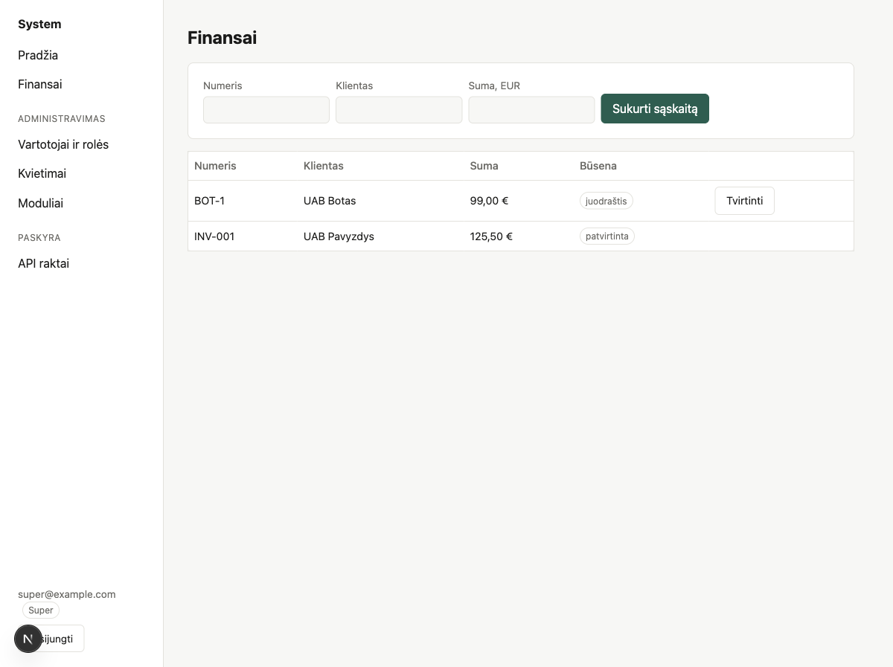

# Darbuotojų nuoma (demo)

Staffing demo (workers, clients, projects, teams, timesheets, planning, logistics, compliance,
invoicing, CRM). For illustration only: it runs on localhost against a local Convex backend.

## Run the demo locally

```bash
pnpm install
pnpm dev            # Next.js on http://localhost:3000 + local Convex (first run: pick "local deployment")
pnpm demo:seed      # in a second terminal: catalog + demo data for every area (safe to re-run)
```

On a fresh machine, do the one-time Convex and `.env.local` setup in [Local development](#local-development)
first. Your sign-in email must be in `SUPER_USER_EMAILS`. To start from clean demo data, run
`pnpm demo:seed -- --reset`.

The rest of this README is the `system-template` guide this app was built from.

---

# system-template

Starter app for a new client system: **Next.js 16 + Convex** on
[`@digimuza/system-core`](../system-core). One client = one copy of this repo,
one Convex deployment, one Infisical project, one Coolify app.

Included, wired end to end:

- **Login**: WorkOS AuthKit (hosted sign-in: email + password, magic code, SSO, Google/Microsoft, whatever the WorkOS environment enables). Convex validates the WorkOS access token.
- **Accounts**: `system:completeSignIn` creates a system user only for a valid invite, or for a verified address in `SUPER_USER_EMAILS`.
- **Permission guard**: server side in every Convex function (`requirePermission`), page routing in `requireSession()`, live UI hints with `<Can>` / `useCan`.
- **Invites**: create, deliver by mail, resend, revoke, accept (`/invite?token=…`).
- **API keys**: create with roles, secret shown once, rotate, revoke; agent REST endpoint at `/api/v1/invoices`.
- **Business module `finance`** from `@digimuza/system-core/finance`: tables, guarded list/create/approve/bulk approve (feature flag), audit; the app adds only the pages.
- **Business module `crm`** from the workspace package `@digimuza/crm` (`packages/crm`): a metadata-driven CRM in the
  spirit of Twenty. Admins configure objects, fields (14 types), select options, relations and shared table/kanban
  views at runtime; records, notes, search and reverse relations follow. See [CRM](#crm).
- **Admin screens**: users and roles, invites, modules and feature flags, audit log (filters, details, CSV export).
- **AI assistant** (`/app/ai`), **global search** (Cmd+K) and **notifications** (bell, email, preferences) from system-core.
- **AI integrations** (`/app/settings/mcp`): connect ChatGPT or Claude to the assistant over MCP with a one-time link; their conversations show up live in `/app/ai`.
- `env.ts` with Zod schemas, `.env.example` (names only), one environment-agnostic Docker image.
- Release cycle: CI on PRs, `release/*` → staging, `production` → same image to production, tags, back-merge, Linear.



## Layout

pnpm workspace (`pnpm-workspace.yaml`): run every command from the repo root.

```
apps/web/                   the client app (Next.js 16 + Convex), package @app/web
  env.ts                    every env var, Zod-validated (public / Next server / Convex)
  modules/                  the business modules this app installs (system-core, packages/*)
  convex/
    system.ts               defineConvexSystem: modules, identity mapping, invite mail; exports all system functions
    auth.config.ts          trusts WorkOS access tokens (WORKOS_CLIENT_ID)
    finance.ts              re-exports the finance module's functions (defineFinance)
    crm.ts                  re-exports the CRM module's functions (defineCrm) and picks its blueprint
    ai*.ts, mcp.ts          AI assistant, its runner and agents; AI integrations over MCP
    search.ts, notifications.ts, roleAdmin.ts   global search, notifications, role editing
    mail.ts                 mail adapter (Resend HTTP; console in development)
    schema.ts               systemTables + module tables + your tables
    *.test.ts               convex-test: sign-in, guard, module toggle, flags, invites, API keys, CRM
  proxy.ts                  AuthKit session refresh (Next 16 proxy); guards nothing
  lib/                      WorkOS URLs and token, server env loader, systemServer()/requireSession(), i18n
  app/
    login, invite           sign-in and invite landing
    app/                    signed-in area (server guard in layout.tsx); app/crm is the CRM UI
    sign-in, callback       WorkOS: start sign-in (PKCE), redirect URI
    auth/complete           after WorkOS: link the system account (invite / Super)
    api/v1/invoices         agent endpoint (Bearer dsk_… key)
    api/health              readiness probe (config loaded and valid)
  scripts/
    start.mjs               container entrypoint: env + Infisical -> process.env, then Next
    deploy-convex.ts        Infisical -> Convex env, convex deploy, system:registerSystem, crm:_applyBlueprint
    ci-secrets.ts           Infisical /ci -> masked GitHub Actions env
    core-source.mjs         switch where @digimuza/system-core comes from
packages/
  crm/                      @digimuza/crm: CRM manifest, tables, field types, blueprints, Convex functions, tests
scripts/                    repo-level release tooling
  coolify-deploy.ts         point a Coolify app at an image tag, deploy, health-check the revision
  linear-transition.ts      DIG-* issues in a commit range -> In Staging / Done
  release-cut.mjs           cut release/X.Y.Z or hotfix/X.Y.Z (version lives in the root package.json)
Dockerfile                  builds apps/web from the whole workspace; server at apps/web/server.js
.github/workflows/          ci.yml, release.yml (staging), production.yml
```


## Create a new client app from this template

Example client: `acme`. Staging `acme.staging.digimuza.ai`, production `acme.digimuza.ai`.

1. **Repo.** GitHub → `digimuza/system-template` → *Use this template* → `digimuza/acme` (private). Clone it.
   Create the `production` branch once: `git push origin main:production`. Track the work in Linear (team DIG):
   a project per client.
2. **Brand it.** In `brand.ts`: the client's name, tagline (LT/EN), logo (`public/brand/…`) and accent colour. Set the
   same logo, colour and font in WorkOS → Branding, so the hosted sign-in page matches. Change `name` in `package.json`. The image name defaults to the repo name (`docker.digimuza.ai/digimuza/acme`).
3. **WorkOS.** One WorkOS environment per app environment (staging, production): see [WorkOS](#workos).
   Note each environment's client ID for step 5.
4. **Convex.** Two deployments that share nothing: staging and production (Convex Cloud projects, or self-hosted
   Convex backends on Coolify). Keep each one's deploy credentials for step 5.
5. **Infisical** (https://infiscal.digimuza.ai). Project `acme`, environments `dev`, `staging`, `prod`. If a machine
   identity created it, add Andrius as admin (see `work/README.md`). In `staging` and `prod`:

   | Path | Keys |
   | - | - |
   | `/` (the app) | `APP_ENV` (`staging` / `production`), `SITE_URL`, `CONVEX_URL`, `CONVEX_SITE_URL`, `WORKOS_CLIENT_ID`, `WORKOS_COOKIE_PASSWORD` (`openssl rand -base64 32`, different per env), optional `WORKOS_API_KEY`, `SUPER_USER_EMAILS`, `MAIL_FROM`, `RESEND_API_KEY`, optional `OPENAI_BASE_URL`, `OPENAI_API_KEY`, `AI_MODEL` (AI assistant via 9Router, copied to Convex) |
   | `/ci` (CI only) | `CONVEX_DEPLOY_KEY` or `CONVEX_SELF_HOSTED_URL` + `CONVEX_SELF_HOSTED_ADMIN_KEY`, `REGISTRY_USERNAME`, `REGISTRY_PASSWORD`, `COOLIFY_TOKEN`, `COOLIFY_APP_UUID` (of that env's Coolify app), optional `LINEAR_API_KEY`, optional `COOLIFY_URL` |

   Two machine identities (Universal Auth), read-only: **runtime** with access to `/` only (for Coolify), and **CI** with
   access to `/` and `/ci` (for GitHub Actions). The running app never sees the deploy, registry or Coolify credentials.
6. **Coolify** (https://coolify.digimuza.ai). Two applications, build pack **Docker Image** (not Dockerfile: CI builds
   the image), image `docker.digimuza.ai/digimuza/acme`, port 3000, health check `/api/health`:
   `acme-staging` (domain `acme.staging.digimuza.ai`) and `acme-production` (`acme.digimuza.ai`). On each, set only:
   `APP_ENV`, `INFISCAL_BASE_URL=https://infiscal.digimuza.ai`, `INFISCAL_CLIENT_ID` and `INFISCAL_SECRET` (runtime
   identity), `INFISCAL_PROJECT_ID`, `INFISCAL_ENV` (`staging` / `prod`), `INFISCAL_PATH=/`. The server must be able to
   pull from `docker.digimuza.ai` (registry login on the Coolify server). Put each app's UUID into Infisical
   `<env>/ci/COOLIFY_APP_UUID`.
7. **GitHub** (repo → Settings). See [Releasing → one-time setup](#one-time-setup).
8. **First release.** `pnpm release:cut 0.1.0`, push the branch, wait for the staging deploy, open a PR
   `release/0.1.0 → production` and merge it with *Create a merge commit*.
9. **First sign-in.** Open the site, sign in with an address from `SUPER_USER_EMAILS`. You are Super.
   Under *Moduliai* enable `finance` (business modules register disabled). Under *Vartotojai ir rolės* create roles
   from subroles, then invite people under *Kvietimai*. Give the client's admin the `Admin` role.
10. **Make it the client's.** Replace or delete `finance` (below). Keep `convex/system.ts` exporting every system function.

### WorkOS

Per WorkOS environment (staging and production are separate WorkOS environments, never shared). In the WorkOS
dashboard → your application:

| Setting | Value |
| - | - |
| Redirects → Redirect URI | `https://<site>/callback` (`http://localhost:3000/callback` in dev) |
| Redirects → Initiate login URI | `https://<site>/sign-in` |
| Redirects → Sign-out redirect | `https://<site>/login` |
| Authentication → **CORS / allowed origins** | `https://<site>` (the account page's WorkOS widgets call WorkOS from the browser) |
| Authentication → **JWT Template** | `{"email": {{ user.email }}, "email_verified": {{ user.email_verified }}}` |

The JWT template is required. WorkOS access tokens carry no email by default, and system-core needs a verified email
to redeem invites and to recognise `SUPER_USER_EMAILS`. Without it, sign-in ends on `/login?state=jwt-template`.

The app derives all three URLs from `SITE_URL` at runtime (not `NEXT_PUBLIC_WORKOS_REDIRECT_URI`, which would be baked
into the image). `WORKOS_API_KEY` is optional: without it AuthKit runs as a public PKCE client, which covers sign-in
and sign-out. Add it only for WorkOS management APIs.

Account page (`/app/account`): WorkOS Widgets for profile, password/MFA and sessions, translated through
`@workos-inc/widgets-i18n`. Users, roles, invites and API keys stay in system-core; don't add WorkOS's
`UsersManagement`, `OrganizationSwitcher` or `ApiKeys` widgets.

Flow: `/login` → `/sign-in` (PKCE, invite token kept in a cookie) → WorkOS → `/callback` (session cookie) →
`/auth/complete` (`system:completeSignIn`) → `/app`.

### Super admin tools

A real Super (verified email in `SUPER_USER_EMAILS`) gets a floating **Super admin tools** toolbar in the bottom-right
corner (it can be minimised to a small button; the choice is remembered per browser).

- **View as role:** see and use the system as a holder of a chosen role. system-core enforces it in every
  decision (business and admin functions, module state, invites, the session); Super rights are off. The toolbar
  shows the role with "Back to Super". Start and stop are audited (`super.role_view.*`).

### UI components

[shadcn/ui](https://ui.shadcn.com) (Radix, Tailwind CSS v4, Lucide icons, Geist font) in `components/ui/`: they're
copied into the repo, so edit them freely per client. App-level pieces (data table on TanStack Table, page header,
empty state, action hook with error toasts) live in `components/app/`. Add more with `npx shadcn@latest add <name>`.
The client's accent from `brand.ts` is shadcn's `--primary`; light/dark follows the OS (`dark` class on `<html>`).

### Agent skills

`.agents/skills/` holds the shared skills from `ai-setup` (credits in its README); `.claude/skills` links to it for
Claude Code.

### Languages

Lithuanian (default) and English. The language is the `locale` cookie (the LT/EN switch on the sign-in screens), else the
browser's preference. Strings live in `lib/i18n/messages.ts`; add a key to both dictionaries or typecheck fails. Server
components use `getT()`, client components `useT()`. Every screen is translated.

### CRM

The `crm` module (`packages/crm`, installed in `apps/web/convex/crm.ts`) is configured on three levels:

| Level | Who | What |
| - | - | - |
| Code, per client app | developer | `defineCrm(system, { blueprint, scanLimit })` in `convex/crm.ts`. `standardBlueprint("lt" \| "en")` gives companies, people and deals with a pipeline; `extendBlueprint(base, { objects, fields, views })` adds the client's own; `emptyBlueprint` starts blank. `pnpm deploy:convex` installs what is missing (`crm:_applyBlueprint`): additive and idempotent, never overwrites admins' changes. |
| Super → Modules | Digimuza operator | Enable `crm`; flags `crm:custom-objects`, `crm:custom-fields`, `crm:kanban`. |
| `/app/crm/settings` (`crm:schema:manage`) | client admin | Objects (names, icon, title field, order, archive), fields (text, long text, number, money, yes/no, date, date and time, select, multi-select, email, phone, link, rating, relation), select options with colours and order, required, relation targets and their reverse name. |
| View menu (`crm:view:manage`) | managers | Shared table and kanban views per object: columns, filters, sort, group-by. |

Roles compose the subroles `crm:viewer`, `crm:member`, `crm:manager`, `crm:admin`. Schema changes are human-only;
agents (API keys) can read and write records with their own roles. Keys and types of fields never change (stored
values depend on them); objects and fields are archived, never deleted, so their data comes back on restore.

Sign-in for the CRM is the app's WorkOS session; there is no separate CRM login. [Twenty](https://github.com/twentyhq/twenty)
is the model for the data model, not a dependency: no Twenty code is included (it is AGPL-3.0, and its OIDC/SAML SSO
is an Enterprise feature).

### Add a business module

Reusable modules live in **system-core** (`@digimuza/system-core/<module>`), changed through
https://github.com/digimuza/system-core, or in a workspace package under `packages/` with the same contract
(`packages/crm` is one); see the `business-module` skill. Installing one in `apps/web`:

1. `modules/index.ts`: add the module's manifest to `appModules`.
2. `convex/schema.ts`: spread its tables (`...financeTables`).
3. `convex/<id>.ts`: re-export its functions (`export const { … } = defineFinance(system)`).
4. Pages under `app/app/<id>/` with `requireSession({ permission })` and `<Can>`; strings in both languages.
5. Deploy; registration adds the new permissions and subroles (disabled until a Super enables the module).

### AI assistant

`/app/ai` is a chat with an assistant that can use the app's business functions as tools, as the signed-in person and
with that person's permissions. It is the `ai` module of `@digimuza/system-core` (`@digimuza/system-core/ai`); the model
runs in a Convex Node action (`convex/aiRunner.ts`, Mastra + OpenAI) and the answer streams into the page through live
queries. Details: `INTEGRATION.md` → "AI assistant" in system-core. The model is reached through **9Router**
(https://router.digimuza.ai/v1), an OpenAI-compatible proxy; the runner uses its Chat Completions API.

- **Files.** `convex/aiConfig.ts` (agents, their instructions and tools; no `"use node"`), `convex/ai.ts` (functions),
  `convex/aiRunner.ts` (`"use node"`, the runner), `...aiTables` in `convex/schema.ts`, `ai` in `modules/index.ts`.
  UI: `app/app/ai/`, `components/ai/`.
- **Enable it.** In Infisical `/` set `OPENAI_BASE_URL=https://router.digimuza.ai/v1`, `OPENAI_API_KEY` = the 9Router
  API key, and optionally `AI_MODEL` = a model name the router exposes (default in `convex/aiConfig.ts`:
  `fast`, a 9Router combo; or any model name such as `cx/gpt-6.1-sol`; the "Išsamus" agent uses the combo `smart`). `pnpm deploy:convex` copies them to the Convex
  deployment, where the runner reads them (locally: `npx convex env set …`). Never put the key in git or `.env*`.
  Without a key the assistant answers "AI model is not configured". Then, as Super, enable the `ai` module.
- **Give access.** Add the `ai:user` subrole (permission `ai:chat:use`) to a role. Each person sees only their own
  threads. What the assistant can *do* depends on the person's other permissions: with `finance:reader` it can list
  invoices; without it, it does not even see the tool.
- **Approvals.** Tools that write (`finance.create_invoice`, `finance.approve_invoice`) stop and show the call with its
  arguments; nothing runs until the person approves. Every call, approval and rejection is audited (`ai.tool.*`).
- **A tool for a new module.** In system-core, next to the module's functions, `defineAiTool({ id: "crm.list_leads",
  permission: "crm:lead:read", input: z.object(…), handler })`: the permission is the module's own, writes set
  `requiresApproval: true`, and the handler checks everything before its first write. Export the tools
  (`crmTools`) and add them to the agent's `tools` in `convex/aiConfig.ts`.
- **Cost.** Model usage is billed per token, on the account behind the 9Router key. Every message sends the thread's
  history, so long threads cost more; watch usage and set limits on the router.

### AI integrations (ChatGPT, Claude over MCP)

The AI assistant (`/app/ai`) lets a person connect ChatGPT, claude.ai / Claude Desktop or Claude Code to it: **"Kopijuoti
MCP nuorodą"** next to "Naujas pokalbis" (and in the empty state) mints a fresh one-time link with the person's roles
and copies it in one click; the slider button beside it ("Daugiau parinkčių") narrows the roles or names the link; the
plug button opens the connections sheet (last use, roles, threads, revoke, new link). `/app/settings/mcp`
("AI integracijos") is the same, as a page, plus everyone's connections for admins. It is the `mcp` module of `@digimuza/system-core` (`@digimuza/system-core/mcp`, needs `ai`). Details,
paths and lifetimes: `INTEGRATION.md` → "AI integrations over MCP" in system-core.

- **Flow.** The person picks roles (capped by their own, like API keys; at least one must allow the assistant) and gets
  a link `https://<SITE_URL>/mcp/c/<code>`, shown once, valid 30 minutes, usable once. Pasted into the client as the MCP
  server URL, it runs OAuth; the authorize step redeems the link (no login) and shows "Prijungta / Connected". The client
  then calls `ask_agent`, `respond_to_approval` (the client asks the person before approving), `list_agents`,
  `list_threads`, `get_thread`. Writes still need approval.
- **What the person sees.** Threads a client started are their own AI threads. The sidebar groups them by source:
  "Mano pokalbiai" first, then one live group per connection (ChatGPT, Claude Code…) with its icon and last activity;
  a group header narrows the list to that connection, and tabs switch Visi / Iš ChatGPT ir Claude / Mano. In a thread a
  banner names the client, the connection and the agent and model that answered; the client's messages are labelled
  "ChatGPT jūsų vardu" and approvals "Patvirtino ChatGPT jūsų vardu". MCP threads are read-only in the app (the
  composer is replaced by a note): the person watches, stops and approves. Live, so with `/app/ai` open you watch the conversation.
  The connections list shows last use and last conversation, links to the threads and revokes (tokens die at once).
  Holders of `mcp:connection:manage` (subrole `mcp:admin`) see and revoke everyone's.
- **Files.** `convex/mcp.ts` (functions), `...mcpTables` in `convex/schema.ts`, `mcp` in `modules/index.ts`,
  `lib/mcp-routes.ts` + `app/mcp/[...path]/route.ts` + `app/.well-known/[...path]/route.ts` (MCP server and OAuth,
  one handler), `/mcp/` and `/.well-known/` excluded in `proxy.ts`. UI: reusable pieces in `components/ai/mcp/`
  (`CopyMcpLinkButton`, `ConnectMcpButton`, `McpConnectionsSheetButton`, `McpConnectionsTable`, `McpSiteUrlProvider`
  set in `app/app/ai/layout.tsx`), used by `components/ai/thread-list.tsx`, `app/app/ai/ai-home.tsx` and the page
  `app/app/settings/mcp/`. Copying `app/app/ai/**` and `components/ai/**` brings the same placement. Dependency: `@modelcontextprotocol/sdk`.
- **Enable it.** As Super, enable `ai` and `mcp`, then add the `mcp:user` subrole to the roles that may connect. No new
  env: `SITE_URL` must be the public origin (it is the OAuth issuer). The reverse proxy must allow responses of up to
  ~90 s on `/mcp/c/*` (the tool waits for the agent and streams progress).
- **Try it locally.** `claude mcp add --transport http local http://localhost:3000/mcp/c/<code>`, then `/mcp` →
  Authenticate. ChatGPT and claude.ai need a public https URL (staging).

### Automations (Automatizacijos)

`@digimuza/system-core/automations`: **On <channel> → AI extraction → insert**. The
"Automatizacijos" nav entry (module `automations` + `automations:automation:read`) has three
pages: the list (`/app/automations`), **Laukia patvirtinimo** (`/app/automations/review`) and the
history (`/app/automations/runs`). A new automation is built in four steps (Kanalas → AI ištraukimas
→ Įrašymas → Teisės ir režimas) with a dry run ("Išbandyti") on a pasted sample, or with
**Sukurti su AI asistentu**, which opens `/app/ai?prompt=…` with the request in the composer.

| File (in `apps/web/`) | What |
| - | - |
| `convex/automationsConfig.ts` | The insert targets: the app's write AI tools (here `finance.create_invoice`). Add a label per target as `auto.target.<id>` in `lib/i18n/messages.ts`. |
| `convex/automations.ts` | `defineAutomations(system, automationsOptions)` functions. |
| `convex/aiConfig.ts` | `defineAutomationsAiTools({ targets })` and `AUTOMATION_INSTRUCTIONS` for the assistant. |
| `app/api/automations/hook/[id]`, `app/api/automations/resend` | Webhook / form (token) and Resend inbound (signed) routes, `lib/automation-routes.ts`. |
| `app/app/automations/*`, `components/automations/*`, `lib/i18n/automations-messages.ts` | Pages, builder, review queue, run history, LT/EN strings. |

Each run acts as the automation's owner through an API key with purpose `automation`: the roles they
picked, capped by their own permissions. Results wait for review unless the automation is in `auto`
mode, which needs the `automations:auto-mode` flag. Subroles: `automations:viewer`,
`automations:reviewer`, `automations:admin`.

Email: every email automation gets its own address `<slug>-<random>@AUTOMATIONS_INBOUND_DOMAIN`.
Point the domain at Resend receiving: either the account's `<id>.resend.app` domain or your own
domain with Resend's MX record. Then add a Resend webhook for `email.received` →
`https://<SITE_URL>/api/automations/resend` and store its signing secret as `RESEND_WEBHOOK_SECRET`.
Reading the email body needs a **full-access** Resend key (`RESEND_RECEIVING_API_KEY`, falls back to
`RESEND_API_KEY`). People forward their mail to the address or use it directly. Other providers
(Postmark, Mailgun, SendGrid, a Cloudflare Email Worker) post to the automation's hook URL with its
token instead. See system-core INTEGRATION.md "Automations".

Convex env (copied from Infisical by `pnpm deploy:convex`): `AUTOMATIONS_INBOUND_DOMAIN`,
`RESEND_WEBHOOK_SECRET`, `RESEND_RECEIVING_API_KEY`, `AUTOMATIONS_AI_MODEL` (all optional), plus the
AI assistant's `OPENAI_*`.

### Gavimas (Ingest)

`@digimuza/system-core/ingest`: the Resend integration, inboxes and the signed inbound webhook.
The "Gavimas" nav entry (module `ingest` + `ingest:inbox:read`) has three pages: **Integracijos**
(`/app/ingest`, the Resend card), **Pašto dėžutės** (`/app/ingest/inboxes`, one inbox at
`/app/ingest/inboxes/<id>` with its linked automations and received mail) and **Gauti laiškai**
(`/app/ingest/emails`).

**Prijungti / Sutvarkyti automatiškai** (`ingest:integration:manage`) creates the Resend webhook for
`email.received` → `https://<SITE_URL>/api/ingest/resend`, stores its signing secret encrypted
(`INGEST_ENCRYPTION_KEY`), removes this site's older webhooks, picks the receiving domain and sends a
test email; repeating it is safe and rotates the secret. With no receiving domain it offers
**Įjungti gavimą subdomene**: a receiving-only subdomain is created in Resend and its DNS records are
shown until verified. Without a session: `npx convex run ingest:_runSetup '{}'`. Email automations
pick an inbox in the builder; older generated addresses become inboxes on the first setup.

Files: `convex/ingest.ts`, `ingestConsumers` in `convex/automationsConfig.ts`, `defineIngestAiTools` in
`convex/aiConfig.ts`, `app/api/ingest/resend` + `lib/ingest-routes.ts`, `app/app/ingest/*`,
`components/ingest/*`, `lib/i18n/ingest-messages.ts`. Convex env: `RESEND_RECEIVING_API_KEY` (full
access), `INGEST_ENCRYPTION_KEY` (`openssl rand -base64 32`), `SITE_URL`; optional
`INGEST_RECEIVING_DOMAIN`, `INGEST_TEST_FROM`, `RESEND_WEBHOOK_SECRET`. See system-core
INTEGRATION.md "Ingest".

### Search, notifications and audit

- **Search (Cmd+K).** `components/search/command-palette.tsx` (mounted in `app/app/layout.tsx`) lists pages the person
  may open, recent items, records from `convex/search.ts` and "Ask the assistant". `convex/search.ts` is
  `defineSearch(system, { providers: [financeSearch] })`: each module ships a provider with its own permission, and the
  server runs only providers whose module is enabled and whose permission the person holds. Add a module's provider there.
- **Notifications.** `notificationsHook()` in `convex/system.ts`, `...notificationTables` in `convex/schema.ts`,
  functions and the email text (LT/EN per type) in `convex/notifications.ts`, mail through `convex/mail.ts`. Modules
  declare their types (`finance.invoice_awaiting_approval`, `roles.role_assigned`); the in-app text is rendered in
  `components/notifications/render.ts`. The bell sits in the nav; `/app/settings/notifications` shows the list and
  per-type channel preferences (in-app, email). Each person sees only their own. A new type needs a case in both renderers.
- **Audit log.** `/app/admin/audit` (permission `audit:event:read`) over `listAudit` / `listAuditFacets`: filters by time,
  actor, module, action and operation ID, event details, and CSV export built in the browser (`auditToCsv`) and itself
  audited (`audit.export`). AI tool runs show up as `ai.tool.*`.

## Local development

Convex commands run in `apps/web` (`cd apps/web`); `pnpm …` scripts run from the root.

```bash
pnpm install
npx convex dev                     # first run: pick or create a dev deployment; writes .env.local
# Convex dev env (once):
npx convex env set APP_ENV development
npx convex env set SITE_URL http://localhost:3000
npx convex env set SUPER_USER_EMAILS you@example.com
npx convex env set WORKOS_CLIENT_ID client_...    # WorkOS staging/dev environment
# Next env: add to .env.local (git-ignored). CONVEX_URL / CONVEX_SITE_URL come from the
# NEXT_PUBLIC_CONVEX_* lines `convex dev` wrote (accepted in development only).
#   APP_ENV=development
#   SITE_URL=http://localhost:3000
#   WORKOS_CLIENT_ID=client_...
#   WORKOS_COOKIE_PASSWORD=<openssl rand -base64 32>
npx convex run system:registerSystem
npx convex run crm:_applyBlueprint
pnpm dev                           # next dev + convex dev
```

Or take everything from Infisical `dev`: `infisical run --env dev -- pnpm dev`
(`export INFISICAL_DOMAIN=https://infiscal.digimuza.ai/api` first).

Register `http://localhost:3000/callback` etc. in the WorkOS environment you use for development (see [WorkOS](#workos)).
Without `RESEND_API_KEY` and with `APP_ENV=development`, invite links are printed to the Convex log
(`npx convex logs`). Any other `APP_ENV` refuses to send without a key.
Without `OPENAI_API_KEY` on the Convex dev deployment, the AI assistant answers "AI model is not configured".

| Command | |
| - | - |
| `pnpm typecheck` | every workspace package: Next app, Convex functions (incl. tests), packages/crm |
| `pnpm lint` | ESLint, every package |
| `pnpm test` | Vitest + convex-test, every package |
| `pnpm build` | `next build` (standalone) |
| `pnpm deploy:convex [--check]` | Convex env, deploy and catalog registration for one environment (`scripts/deploy-convex.ts`) |
| `pnpm release:cut X.Y.Z [--hotfix]` | cut `release/X.Y.Z` (or `hotfix/X.Y.Z`) and bump the version |

## Releasing

```
feature/DIG-123-x ──PR──▶ main ──cut──▶ release/X.Y.Z ──PR (merge commit)──▶ production
                          CI only        build image once,                    same image → production,
                                         deploy → staging                     tag vX.Y.Z, back-merge → main
```

| Branch | Workflow | What happens |
| - | - | - |
| PR to any branch, push to `main` | `ci.yml` | typecheck, lint, test, build, Docker build (no push) |
| push to `release/X.Y.Z` or `hotfix/X.Y.Z` | `release.yml` | checks; version must equal `package.json`; build and push `docker.digimuza.ai/digimuza/<app>:X.Y.Z-<sha7>` (and `:X.Y.Z`); deploy Convex staging; point `<app>-staging` at the image; wait for `/api/health` to report that commit; Linear `DIG-*` → **In Staging** |
| merge into `production` | `production.yml` | find the release head (second parent of the merge), require its image to exist (**never rebuilds**), add tags `:vX.Y.Z` and `:production`, deploy Convex prod from that commit, point `<app>-production` at the same image, health check; tag `vX.Y.Z`, GitHub Release, back-merge `production` → `main` (direct push, or a PR if `main` is protected or conflicts); Linear → **Done** and a project update |

### Cutting a release

```bash
git switch main && git pull
pnpm release:cut 1.2.0              # creates release/1.2.0 from origin/main, bumps package.json, commits
git push -u origin release/1.2.0    # → staging
linear milestone create --project <app> --name v1.2.0 -y   # optional, put the shipping issues on it
```

Only fixes go into the release branch after the cut. Each push rebuilds the image and redeploys staging. When staging
is good, open a PR `release/1.2.0 → production` and merge it with **Create a merge commit** (not squash or rebase: the
merge's second parent identifies the tested image). Hotfix: `pnpm release:cut 1.2.1 --hotfix` branches from
`production`, then the same path.

**Rollback / redeploy:** Actions → *Release (production)* → *Run workflow* with `image_tag` (e.g. `1.1.0-abc1234`).
It redeploys that image and the Convex code from its commit. Convex changes must stay backward compatible with the
previous release (deploy order is Convex first, then the image).

### One-time setup

In the GitHub repo (Settings):

- **Variables** (repository): `DEPLOY_ENABLED=true` (without it only the checks run, as on the template repo),
  `INFISCAL_PROJECT_ID`. Optional: `APP_NAME` (default: repo name), `REGISTRY` (default `docker.digimuza.ai`),
  `REGISTRY_NAMESPACE` (default `digimuza`), `INFISCAL_BASE_URL`, `LINEAR_PROJECT` (project slug or ID, for project
  updates), `STAGING_URL`, `PRODUCTION_URL`.
- **Environments** `staging` and `production`, each with secrets `INFISCAL_CLIENT_ID` and `INFISCAL_SECRET` (the CI
  machine identity). Add required reviewers on `production` if releases need a second pair of eyes.
- **Branch protection** on `production`: require a PR and the `CI` checks, allow merge commits. Optionally the same on
  `main` (back-merges then arrive as PRs).

```bash
gh variable set DEPLOY_ENABLED --body true
gh variable set INFISCAL_PROJECT_ID --body <id>
for env in staging production; do
  gh secret set INFISCAL_CLIENT_ID --env $env
  gh secret set INFISCAL_SECRET --env $env
done
```

The Linear step is optional: without `LINEAR_API_KEY` in Infisical `/ci` it is skipped, and it never fails a deploy.
Issue IDs are found in the commit messages and branch names (`feature/DIG-123-x`) of the release.

## @digimuza/system-core version

The app depends on the **`latest`** npm version of `@digimuza/system-core`, pinned exactly in `package.json`.
system-core publishes `X.Y.Z-rc.N` under the npm tag `next` from its release branches; client apps don't use those.

| Command | Effect |
| - | - |
| `pnpm core:npm` | Pin the version behind npm `latest` (refuses a prerelease). Run when system-core ships a release. |
| `pnpm core:npm 0.2.0-rc.1` | Try a release candidate on a feature branch. Don't release it. |
| `pnpm core:link` | `link:../system-core` for editing both at once. Local only; switch back before committing. |
| `pnpm core:vendor` | Pack `../system-core` into `vendor/` (fallback when npm is unavailable). |

Gaps found in the package while building this template: [docs/system-core-notes.md](docs/system-core-notes.md).

## Security notes

- Every Convex function checks the actor itself; pages and `<Can>` only decide what is shown.
- Anyone allowed by the WorkOS environment can get a WorkOS session; it grants nothing without a system account (invite or `SUPER_USER_EMAILS`). Restrict sign-up in WorkOS too if the client wants that.
- The invite token never goes to WorkOS: `/sign-in` keeps it in an httpOnly cookie scoped to `/auth/complete`.
- Agent keys never act as Super and are capped by the owner's current permissions. `/api/v1/*` passes the key to Convex and decides nothing.
- MCP connections act through a hidden agent key with the link's roles, so the same caps apply; `/mcp/*` and `/.well-known/*` only speak HTTP, Convex decides. Link codes, OAuth codes and tokens are stored hashed. A connection only sees the threads it started.
- Secrets live in Infisical. Config errors name keys, never values. The browser receives only `CONVEX_URL`; CI-only credentials sit in `/ci`, out of the app's reach.
- Roll back with the *Release (production)* workflow and `image_tag`, not Coolify's "rollback to image": the workflow
  also redeploys the matching Convex functions and catalog.
